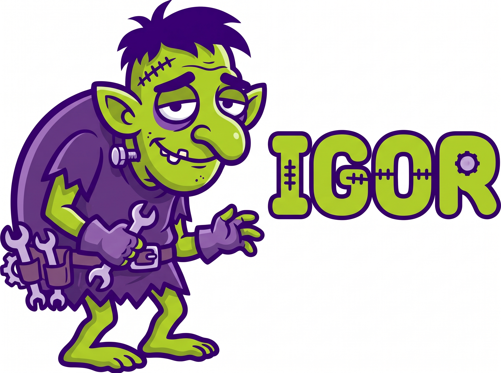

<p align="center">
  
</p>

# igor

_Frankenstein's assistant: it serves your PHP projects through [FrankenPHP](https://github.com/php/frankenphp) so you don't have to._

Local PHP sites on macOS with the ValueQuest FrankenPHP suite: Laravel, Symfony, WordPress or plain PHP. It replaces Herd with a central Caddy proxy in front of one FrankenPHP backend per app.

```
Browser ──https://app.test──▶ front proxy (Caddy local CA, :80/:443)
                                 └──▶ http://127.0.0.1:81xx  FrankenPHP (per site, HTTPS=on)
App ────http://127.0.0.1:81xx──▶ other site directly (no TLS, like prod)
```

## Contents

- [Install and setup](#install-and-setup)
  - [Trying igor next to Herd](#trying-igor-next-to-herd)
- [Update](#update)
  - [New and dropped PHP versions](#new-and-dropped-php-versions)
- [Daily use](#daily-use)
  - [Switching a project's PHP version](#switching-a-projects-php-version)
- [Workers (Reverb, queues, scheduler, ...)](#workers-reverb-queues-scheduler-)
- [Services (Redis, Mailpit, S3)](#services-redis-mailpit-s3)
- [PHP on the command line](#php-on-the-command-line)
- [PHP runtimes (ValueQuest FrankenPHP suite)](#php-runtimes-valuequest-frankenphp-suite)
  - [Requirements for the darwin build](#requirements-for-the-darwin-build)
- [Development & Releases](#development--releases)
- [Files](#files)
- [Notes](#notes)

## Install and setup

You need macOS with [Homebrew](https://brew.sh). igor is a single native Go binary with zero runtime dependencies.

```bash
# 1. download igor from GitHub Releases (Apple Silicon; use amd64 for Intel)
curl -fsSL https://github.com/value-quest/igor/releases/latest/download/igor-darwin-arm64 -o /usr/local/bin/igor
chmod +x /usr/local/bin/igor

# 2. install the PHP runtimes (no sudo)
igor install

# 3. quit Herd if it runs (it holds ports 80/443), then set up DNS, proxy and certificates
igor setup

# 4. load direnv and the igor PHP commands in your shell
echo 'eval "$(direnv hook zsh)"' >> ~/.zshrc
echo 'export PATH="$HOME/.igor/bin:$PATH"' >> ~/.zshrc   # last line, after Herd's

# 5. serve your first project
cd ~/Code/portal && igor add portal       # https://portal.test
```

<details><summary>Building from source</summary>

Build locally with Go 1.24+:

```bash
git clone https://github.com/value-quest/igor.git ~/igor
cd ~/igor && make build
ln -s ~/igor/igor ~/bin/igor              # or any folder on your PATH
```

</details>

**`igor install`** downloads the latest [FrankenPHP suite](#php-runtimes-valuequest-frankenphp-suite) release for every PHP version it ships (currently 8.4 and 8.5) into `~/frankenphp/php8.x`. It runs each archive's own `install.sh --versioned 8.x` and checks that `php` and `frankenphp` start. Run it as your normal user, without sudo.

**`igor setup`** installs dnsmasq and direnv through Homebrew. It points `*.test` to 127.0.0.1, starts the front proxy as a LaunchAgent, puts the Caddy local CA into the macOS keychain and creates the `php`/`php84`/`php85` commands in `~/.igor/bin`. It asks for sudo for dnsmasq (port 53) and for `/etc/resolver/test`.

<details><summary>Installing the PHP runtimes by hand (what <code>igor install</code> does)</summary>

Run it as your normal user, **without sudo**. Always use `--versioned` on macOS: the normal install writes to `~/bin` and `~/.bash_profile` and looks for running servers through `/proc`, which macOS doesn't have.

```bash
cd /tmp
gh release download -R value-quest/franken-php -p 'frankenphp-darwin-arm64-*' --clobber

for v in 8.4 8.5; do
  short=php${v/./}                       # php84, php85
  rm -rf "/tmp/fp-$short" && mkdir "/tmp/fp-$short"
  tar -xzf "frankenphp-darwin-arm64-$short.tar.gz" -C "/tmp/fp-$short"
  "/tmp/fp-$short/install.sh" --versioned "$v"
done
```

</details>

### Trying igor next to Herd

igor and Herd both need ports 80/443, so only one of them can run at a time:

```bash
igor stop     # proxy, sites, workers, services; they stay stopped after a restart of the Mac
              # -> start Herd
igor start    # quit Herd first; igor refuses to start while 80/443 are taken
```

Your sites, configs and service data stay as they are in between. dnsmasq keeps running; it sends `*.test` to 127.0.0.1 for igor and Herd alike.

## Update

```bash
igor update --check     # installed vs. available PHP and FrankenPHP versions, changes nothing
igor update             # install what's new, then restart everything on it
igor update --force     # reinstall even if up to date, e.g. after a build fix
igor self-update        # update igor itself from GitHub Releases
```

**`igor update`** compares your runtimes with the latest suite release, installs only what changed and then runs `igor refresh --restart`. That restarts the proxy, sites, workers and services on the new binaries. It's the same command as `igor install`; only the name differs.

The suite rebuilds its archives every day into a release tagged with the FrankenPHP version, so igor compares versions instead of tags or dates. The versions come from the release's `versions.json` (`{"frankenphp": "1.13.5", "php84": "8.4.28", "php85": "8.5.13"}`). A daily rebuild with the same versions counts as up to date; a new PHP patch or FrankenPHP version gets installed. igor records what it installed in `~/frankenphp/php8.x/.igor-release`. Runtimes installed by hand show as `?` until their first `igor update`.

The installer keeps the previous version as `~/frankenphp/php8.x.backup.<date>`, and igor keeps only the newest backup. To roll back, move the backup back to `php8.x` and run `igor refresh --restart`.

### New and dropped PHP versions

When the suite adds a minor version (e.g. 8.6), `igor update` installs it next to the others. Switch a project by changing its `.php-version` (see [Switching a project's PHP version](#switching-a-projects-php-version)).

When the suite drops a version, `igor update --check` lists it as "no longer in the release". Move its projects to another version, then remove it:

```bash
igor uninstall 8.4      # asks first; --yes skips the question
```

`uninstall` deletes `~/frankenphp/php8.4` and its backups. It refuses while a site still uses that version, and it won't remove the last runtime, which the front proxy needs. Afterwards it runs `igor refresh`, so the proxy and the `php8x` commands move to the remaining versions.

## Daily use

```bash
cd ~/Code/portal && igor add portal       # https://portal.test, PHP picked as below
cd ~/Code/sso    && igor add sso --php 8.4
cd ~/Code/blog   && igor add blog --docroot .   # WordPress: serve the project folder itself
igor proxy reverb 8080                    # route to a service you run yourself
igor service add redis -- redis-server    # background service, see below
igor list
igor stop portal / start portal / logs portal
igor stop / igor start                    # everything, e.g. to switch to Herd and back
git checkout dev                          # .php-version / Procfile.dev changed: the watcher switches the site
igor logs portal:watch                    # what the watcher did
igor workers                              # sync Procfile.dev workers by hand
igor refresh portal                       # same as the watcher, by hand
igor refresh                              # regenerate everything, restart what changed
igor info sso                             # internal URL + .env hints
igor doctor                               # check dnsmasq, resolver, proxy, Herd, runtimes & sites
```

`add` serves `public/` if the project has one (Laravel, Symfony, Slim, ...) and the project folder itself otherwise. For anything else, pass `--docroot` with a folder inside the project, e.g. `--docroot web`. Requests for files that don't exist go to the document root's `index.php`, which is what front controllers and WordPress permalinks need. To change the document root, run `igor rm <name>` and add the site again.

`add` picks the PHP version from, in this order: `--php 8.x`, the project's `.php-version`, `config.platform.php` in `composer.json`, else the newest installed version. It prints where the version came from. It writes the result to `.php-version` and adds an `.envrc`. Inside the project, `php`, `composer` and `frankenphp` then come from the shared runtime, and that includes Claude Code when you start it there.

`add` also starts a watcher for the site. When the project's `.php-version`, `composer.json` or `Procfile.dev` changes, by editing it or by switching branches, the watcher moves the site and its workers to the new settings and shows a macOS notification. You don't need to run anything after a `git checkout`. See [Switching a project's PHP version](#switching-a-projects-php-version).

### Switching a project's PHP version

Change the project's `.php-version`. igor picks it up by itself:

```bash
cd ~/Code/portal
echo 8.5 > .php-version                   # or: git checkout a branch with another .php-version
                                          # a moment later: "portal now runs PHP 8.5 (was 8.4)"
```

Each site has a watcher that runs `igor refresh <site>` whenever the project's `.php-version`, `composer.json` or `Procfile.dev` changes. That covers editing the file, `git checkout`, `git pull` and rebases, so branches can pin different versions (e.g. `dev` on 8.5, `prod` on 8.4). Each branch should commit its own `.php-version`. A branch without one falls back to `config.platform.php` in its `composer.json`. If neither is there, the site stays on its current version and the notification says so. The fallback doesn't create a `.php-version`. The refresh rewrites the site's FrankenPHP config and LaunchAgent and those of its workers, restarts the ones that run, and shows a macOS notification. `igor logs <site>:watch` shows what the watcher did. `igor refresh <site>` does the same by hand.

On the command line, the switch takes effect right away. Inside the project, direnv puts the new runtime on PATH (it may ask for `direnv allow` once). The `php` command from `~/.igor/bin` reads `.php-version` (or `composer.json`'s `config.platform.php`) from the current folder upwards as well. direnv's `.envrc` only reads `.php-version`.

Only installed versions work. If `.php-version` names one that isn't installed, the site stays on its current version and the notification says so; `igor install` gets the missing one if the suite ships it. Composer dependencies aren't touched: if the branches need different ones, run `composer install` yourself. Commit `.php-version` if your team should use the same version.

Sites added before the watcher existed get one with the next `igor refresh`.

## Workers (Reverb, queues, scheduler, ...)

Long-running commands go in a `Procfile.dev` in the project root, one `name: command` per line:

```
reverb:   php artisan reverb:start
queue:    php artisan queue:listen --tries=3
schedule: php artisan schedule:work
```

`igor add` starts them along with the site. When the file changes, by editing it or by switching branches, the site's watcher applies it: new lines start, changed ones restart, deleted ones stop. `igor workers` does the same by hand.

Each worker is a LaunchAgent, like the site itself. It starts at login and restarts when it exits, at most once every 10 seconds. Commands run in the project folder through bash, with the site's PHP first on PATH, followed by `vendor/bin` and `node_modules/.bin`.

```bash
igor list                       # workers appear under their site
igor logs portal:reverb         # ~/.igor/logs/portal@reverb.log
igor restart portal:queue       # one worker
igor restart portal             # the site and all its workers
igor stop portal                # same for stop/start
```

Locally, prefer `queue:listen` over `queue:work`: it picks up code changes without a restart. Only list commands that keep running. A command that exits is started again every 10 seconds.

## Services (Redis, Mailpit, S3)

Shared services run natively as LaunchAgents too. You don't need Docker or a VM. Install the binary, then hand igor the command:

```bash
brew install redis mailpit

igor service add redis -- redis-server --port 6379
igor service add mail --route 8025 -- mailpit --smtp 127.0.0.1:2525 --listen 127.0.0.1:8025 --database mailpit.db
igor service add s3 --route 9001 --env MINIO_ROOT_USER=admin --env MINIO_ROOT_PASSWORD=change-me \
    -- silo server . --address 127.0.0.1:9000 --console-address 127.0.0.1:9001
```

- Each service runs in `~/.igor/data/<name>`, so relative paths in the command (Redis' `dump.rdb`, `mailpit.db`, `.` for Silo) keep their data there.
- `--route PORT` serves the service's web UI as `https://<name>.test`, e.g. `https://mail.test` for Mailpit.
- `--env KEY=VALUE` sets environment variables. You can repeat it.
- Commands without a path are looked up in Homebrew first. Silo has no formula: download the macOS binary from its GitHub releases and pass its full path. Check its arguments by hand once first; the line above assumes it works like MinIO.
- To change a command, run `igor service add` again with the same name. igor restarts the service only if something changed.
- `igor start|stop|restart|logs|info <name>` work as for sites. `igor rm <name>` removes the service and keeps its data.

Apps connect directly, without the proxy:

```dotenv
REDIS_HOST=127.0.0.1
MAIL_HOST=127.0.0.1
MAIL_PORT=2525
AWS_ENDPOINT=http://127.0.0.1:9000
AWS_USE_PATH_STYLE_ENDPOINT=true
```

## PHP on the command line

`igor setup` (or `igor shims` on its own) puts shims in `~/.igor/bin`:

| Command | PHP version |
|---|---|
| `php`, `composer`, `frankenphp` | nearest `.php-version` (or `composer.json` with `config.platform.php`) from the current folder upwards, else the newest installed |
| `php84`, `composer84`, `frankenphp84`, `php85`, ... | that version, always |

They work in any folder: no direnv and no `igor add` needed. Put `~/.igor/bin` first on PATH, at the end of `~/.zshrc` so it comes after Herd's lines:

```sh
export PATH="$HOME/.igor/bin:$PATH"
```

`igor update`, `igor uninstall` and `igor refresh` keep the numbered commands in sync with the installed runtimes.

## PHP runtimes (ValueQuest FrankenPHP suite)

igor uses the darwin builds from [value-quest/franken-php](https://github.com/value-quest/franken-php), installed side by side with `--versioned`:

```
~/frankenphp/php8.4/bin/{frankenphp,php,composer}
~/frankenphp/php8.5/bin/{frankenphp,php,composer}
```

All projects share these two runtimes. Each project picks one in its `.php-version`, so a PHP update is a single install, not one per project.

### Requirements for the darwin build

Each binary must run straight from its folder. On macOS that means dylibs in `../lib`, found through an `@executable_path/../lib` rpath, instead of the `LD_LIBRARY_PATH` wrappers used on Linux. igor never calls a binary from a project folder.

## Development & Releases

```bash
make test       # runs unit tests + byte-for-byte backwards-compatibility tests against `main`
make build      # builds ./igor for your current macOS architecture
make dist       # cross-compiles dist/igor-darwin-{arm64,amd64}
```

Releases are automated via [GoReleaser](.goreleaser.yaml) and [GitHub Actions](.github/workflows/release.yml). Push a version tag to build and publish a GitHub Release:

```bash
git tag v2.0.0 && git push --tags
```

GoReleaser builds macOS `arm64`/`amd64` binaries (`igor-darwin-arm64`, `igor-darwin-amd64` for `igor self-update`, plus `.tar.gz` archives) and publishes them to GitHub Releases.

## Files

| Path | What |
|---|---|
| `~/.igor/sites.tsv` | registry: name, port, type, PHP version, folder |
| `~/.igor/Caddyfile`, `~/.igor/sites/*.caddy` | front proxy config, one route per site |
| `~/.igor/backends/*.Caddyfile` | generated FrankenPHP config per site (sets `HTTPS=on` for PHP) |
| `~/.igor/php/99-igor.ini` | shared php.ini settings (web and CLI, via `PHP_INI_SCAN_DIR`) |
| `~/.igor/data/<service>/` | working folder and data of each service |
| `~/.igor/logs/` | one log per site and per worker (`<site>@<worker>.log`), plus `proxy.log` |
| `~/Library/LaunchAgents/dev.igor.*.plist` | LaunchAgents for the proxy, sites and workers (`<site>@<worker>`): start at login, restart if they crash. Plus one watcher per site (`<site>~watch`) that runs on changes to `.php-version`, `composer.json` or `Procfile.dev` |

## Notes

- Everything igor runs starts at login. `igor stop <name>` stops a site, worker or service and keeps it stopped after a restart of the Mac, until `igor start <name>`. An idle FrankenPHP server uses a few tens of MB.
- PHP sees every request as HTTPS (`HTTPS=on`), so Laravel, Symfony and WordPress generate `https://` URLs and assets behind the front proxy without trusting any proxy. That includes direct calls to `http://127.0.0.1:<port>`. The client IP is still `127.0.0.1`.
- Logs are not rotated. `igor logs --clear <name>` empties one (`portal:queue` for a worker), `igor logs --clear` all of them. Running services keep logging into the emptied file.
- The front proxy listens on all interfaces, so sites are reachable from your LAN unless the macOS firewall blocks them. Binding only to 127.0.0.1 on ports 80/443 needs root on macOS.
- The Go rewrite is 100% backwards compatible with existing `~/.igor` registries, Caddyfiles, shims, logs, and LaunchAgent plists from `main`. Run `make test` to execute the unit test suite.
